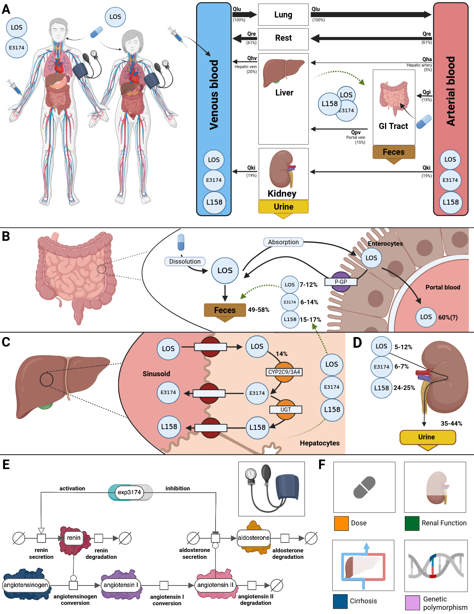

# Physiologically based pharmacokinetic/pharmacodynamic (PBPK/PD) model of losartan

This repository provides the losartan physiologically based pharmacokinetic/pharmacodynamic (PBPK/PD) model: the oral absorption of losartan, its distribution, its hepatic metabolism to the active metabolite E3174 (CYP2C9) and to inactive metabolites, the renal and biliary excretion of losartan and its metabolites, and the blockade of the AT1 receptor by E3174 with its effects on renin, angiotensin, aldosterone and the blood pressure.

## How to cite

> Tensil, E., Myshkina, M. & König, M. (2026). *Physiologically based pharmacokinetic/pharmacodynamic (PBPK/PD) model of losartan*. Zenodo. https://doi.org/10.5281/zenodo.14761114

## License

* Source Code: [MIT](https://opensource.org/license/MIT)
* Documentation: [CC BY-SA 4.0](https://creativecommons.org/licenses/by-sa/4.0/)
* Models: [CC BY-SA 4.0](https://creativecommons.org/licenses/by-sa/4.0/)

This program is distributed in the hope that it will be useful, but WITHOUT ANY
WARRANTY; without even the implied warranty of MERCHANTABILITY or FITNESS FOR A
PARTICULAR PURPOSE.

## Funding

Mariia Myshkina was supported by the Federal Ministry of Research, Technology and Space (BMFTR, Germany) within ATLAS by grant number 031L0304B and by the German Research Foundation (DFG) within Priority Programme SPP 2311 by grant number 465194077 (Subproject SimLivA). Matthias König was supported by the Federal Ministry of Research, Technology and Space (BMFTR, Germany) within ATLAS by grant number 031L0304B and by the German Research Foundation (DFG) within the Research Unit Program FOR 5151 QuaLiPerF (Quantifying Liver Perfusion-Function Relationship in Complex Resection - A Systems Medicine Approach) by grant number 436883643 and by grant number 465194077 (Priority Programme SPP 2311, Subproject SimLivA). This work was supported by the BMBF-funded de.NBI Cloud within the German Network for Bioinformatics Infrastructure (de.NBI) (031A537B, 031A533A, 031A538A, 031A533B, 031A535A, 031A537C, 031A534A, 031A532B).

&copy; 2024-2026 Ennie Tensil, Mariia Myshkina and Matthias König
